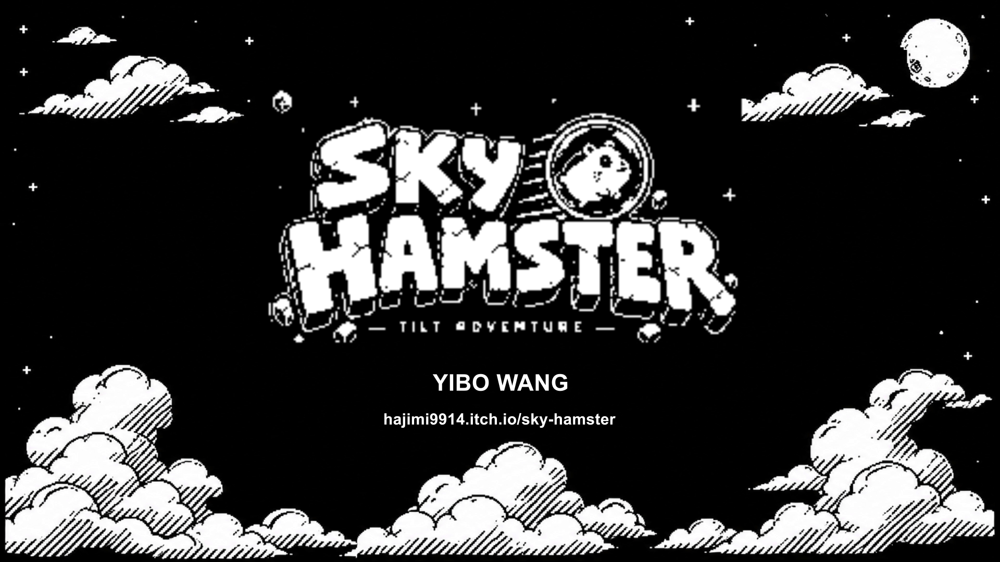
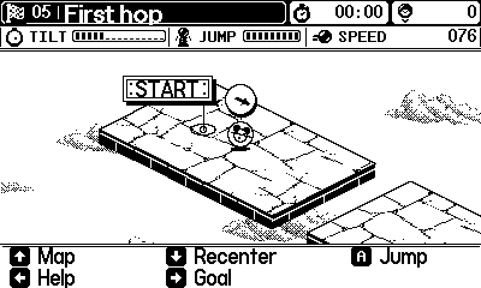
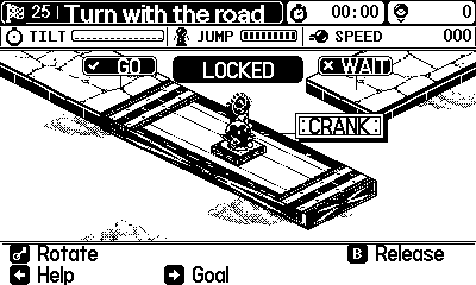
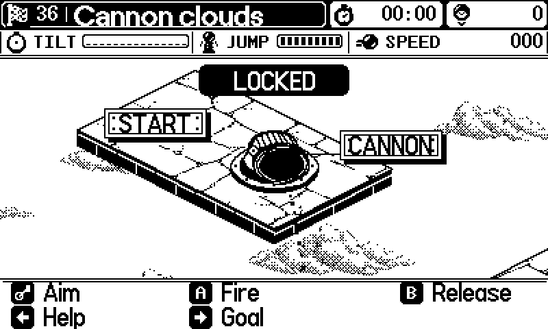

# Sky Hamster

**A tilt-and-crank rolling adventure for Playdate.** Guide a hamster in a glass ball along suspended stone roads, build momentum to cross gaps, and operate machinery to reach the finish without falling.

**v0.12.12 · 53 courses · Single player · Playdate**

**Designed by Yibo Wang / 王奕博** — game design, gameplay systems, interaction design, course progression, and creative direction.

> **Playdate hardware is required for the intended released experience.** Steering and lift-to-jump use its accelerometer; the physical crank operates machinery. The `.pdx` download is not a browser game or native Windows executable. The SDK Simulator is a development preview, not a replacement for testing handheld controls.

**[Download the Playdate version on itch.io](https://hajimi9914.itch.io/sky-hamster)** · **[Install / sideload](docs/PLAY.md)** · **[Design film · 2:59](https://www.youtube.com/watch?v=iNOELVQz9kg)** · **[Selected portfolio · 8 pages](portfolio/Selected.pdf)**

*Illustrated promotional cover. The film uses Simulator capture, English narration, and captions.*

## Tilt to roll. Counter-tilt to recover.

Tilting applies force, not a position or fixed speed. A bend asks for anticipation: ease input, lean against your motion, then build speed toward the next opening. The overhead arrow shows **applied input**, not velocity, so a correction becomes visible before the ball finishes slowing.

Hold comfortably and still to calibrate each course. **Down / Recenter** makes the current stable grip neutral; it does not erase velocity. **Road** steering (the default) follows the isometric axes; **Screen** follows screen directions. This choice answers a real playtest problem: newcomers differed in whether they expected rightward tilt to mean screen-right or along the diagonal road.

### A gap tests the approach, not just the jump button

Build enough speed, quickly lift the whole device perpendicular to its screen—or use **A**—and correct the landing. Momentum continues in air and on landing; recovery prevents immediate repeated jumps. Early courses establish rolling first; later gaps change the run-up and exit.

### The crank changes the route beneath you

Enter a control point slowly to **LOCK** the ball. Crank movement raises a lift, moves a shuttle, rotates a bridge, extends a crossing, redirects wind, or selects a gate route. Accumulated rotation changes the machine directly; this is not a speed-charging gesture. **GO / WAIT** reports each actual connection separately, preserving continuous rotation instead of snapping to an answer.

**B** releases; leave the control area before returning to dock again. The locked/free distinction lets players adjust machinery without simultaneously balancing. Automatic ferries and platforms instead demand timing; they are not crank-controlled.

### A cannon commits you to a landing

Dock, aim within the horizontal arc, read the trajectory from the muzzle, then press **A / Fire**. Offset receivers and later relays make aiming matter and leave braking space. A successful shot still leaves a moving ball to control. **B** exits before firing if the setup is wrong.

*These GIFs are actual v0.12.9 Simulator rendering with scripted inputs and an isolated save. The interactions remain in v0.12.12. They are not handheld footage or synthetic gameplay art.*

## Learn a rule, then meet it in a different situation

The campaign has **20 teaching chapters followed by four expeditions, across 53 courses**. Short introductions isolate decisions; cumulative reviews change context. Each finale revisits all mechanism families, rather than ending with the latest feature developed.

Conveyors change grounded motion; intermittent jets create timing windows; magnets require early correction; low circular bumpers rebound on real side contact. Slopes, narrow roads, waiting islands, height changes, and angled receivers change how controls are used. Checkpoints shorten recovery; saved progress and best times support replay.

For a quick visit, **Settings → hold A+B about 2.5 seconds** enables temporary developer access. Use Playdate **Menu → Level select** to explore all courses. Repeat the chord or restart to leave; test clears/times stay separate from normal progress. [Controls and exploration](docs/PLAY.md#explore-without-unlocking-every-course).

## Design work and its evidence

My focus was input mapping, momentum/recovery, mechanism rules, course sequencing, tutorials, feedback, and visual direction. Implementation, art production, recording, and testing used tool assistance; [credits](CREDITS.md) distinguish those contributions.

- **Learnable controls:** stranger playtests led to stronger opposing braking; I then restored most acceleration when softer input required an uncomfortable lean. [Decision](experiments/tilt-adventure/REFLECTION.md#user-content-entry-08).
- **Readable contact:** an upright spring became a low elastic ring matching lateral rebound to its visible surface; expansion stays visual-only. [Decision](experiments/tilt-adventure/REFLECTION.md#user-content-entry-16).
- **Hardware trade-offs:** prebaked fixed art and camera-near road images reduce runtime work, with collision ready first. Measurements and remaining slow scenes are retained. [Decision](experiments/tilt-adventure/REFLECTION.md#user-content-entry-12).

## Read the process or the source

| Explore | Inside |
| --- | --- |
| [Development Journal / 开发日志](docs/JOURNAL.md) | English-first / Chinese-below reflections, version notes, and performance retrospectives. |
| [Design Iterations / 设计迭代](DESIGN_LOG.md) | Early speed, force, latch, and jump decisions, with reconstructions labeled. |
| [Eight control experiments](experiments/control-variants/README.md) | Alternatives and comparison questions, not eight current-game editions or fabricated test results. |
| [Guided source tour](docs/CODE.md) | Trace tilt, docking, passage feedback, and persistent course identity. |
| [Build the current game](docs/BUILD.md) | SDK, structure, compilation, optional checks, and installation. |
| [Complete portfolio · 10 pages](portfolio/Complete.pdf) | Expanded visual breakdown alongside the selected edition above. |

**Current source:** [`experiments/tilt-adventure/source`](experiments/tilt-adventure/source). Root `source/` and root build tasks preserve the earlier crank-propulsion game. [Version mapping](docs/VERSIONS.md) keeps both histories traceable.

Physical-device verification is recorded with separate scopes for the v0.12.9 campaign sweep and later targeted release checks—not manual completion of every route. [Release evidence](docs/RELEASE.md). Desktop adaptation is a possible future direction, not an included platform.

Source is public for inspection. No new blanket open-source license is granted; third-party terms remain in [Credits](CREDITS.md) and retained license files.
