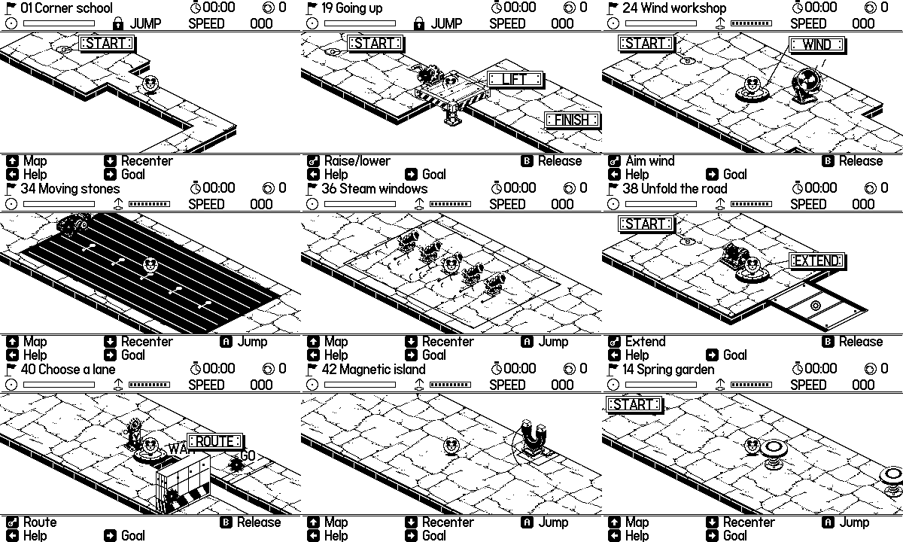

# 0.10.0 machinery and paving assets

Seven transparent machinery masters and one opaque paving master were generated for this release. Runtime PNGs are thresholded to black/white; white is solid paint, alpha remains transparent. Prompts and originals are retained so the material set can be revised consistently.

## Export

Run `prepare-details.ps1` and `prepare-paving.ps1` in this folder. Gear and fan orientations and spring compression frames are prepared once when the game starts. Paving uses sixteen 32×32 tiles from a 128×128 atlas; slope projection is cached before stamping into terrain chunks. The first paving generation was rejected because it was black; only `paving-original.png` is used.

## Asset map

| File prefix | Use | Runtime size |
|---|---|---|
| detail-roller | Conveyor motor/end roller | 52×42 |
| detail-nozzle | Timed steam outlet | 32×34 |
| detail-winch | Extending bridge controller | 48×42 |
| detail-switch | Paired gate controller | 40×48 |
| detail-magnet | Electromagnet and pedestal | 48×54 |
| detail-gear | Shared animated transmission | 24×24 |
| detail-blade | Fan rotor | 26×26 |
| paving | Irregular stone road material | 16 tiles, 32×32 each |

Earlier lift, ferry, fan housing, spring and cannon masters remain in use; their animated parts are layered separately. Variable-size decks and shutters retain geometry-matched metal panels, rivets and edge rails so their visible shape follows support and collision.

## Generation prompts

### roller

Mode: transparent sprite

Use case: stylized-concept. Production sprite for Sky Hamster, a polished monochrome Playdate rolling-ball game. BLACK AND WHITE only, chunky deliberate pixel art, no gray, no text. Isometric 2:1 top-down three-quarter view, thick dark outline and clear white highlights, toy-like sturdy machinery, readable when reduced to 48-64 pixels. Single isolated complete object, transparent background. A compact conveyor drive motor and paired toothed rollers in a thick riveted chassis. Short belt section wraps around two large rollers; visible gear at side. No long floor, no characters. This is an end-cap attached to a larger conveyor.

### nozzle

Mode: transparent sprite

Use case: stylized-concept. Production sprite for Sky Hamster, a polished monochrome Playdate rolling-ball game. BLACK AND WHITE only, chunky deliberate pixel art, no gray, no text. Isometric 2:1 top-down three-quarter view, thick dark outline and clear white highlights, toy-like sturdy machinery, readable when reduced to 48-64 pixels. Single isolated complete object, transparent background. A squat industrial steam nozzle mounted in a bolted diamond base, large round upward-and-right-facing outlet, chunky elbow pipe, pressure gauge and two valve ribs. No steam: steam is animated separately. Clear outline and uncluttered silhouette.

### winch

Mode: transparent sprite

Use case: stylized-concept. Production sprite for Sky Hamster, a polished monochrome Playdate rolling-ball game. BLACK AND WHITE only, chunky deliberate pixel art, no gray, no text. Isometric 2:1 top-down three-quarter view, thick dark outline and clear white highlights, toy-like sturdy machinery, readable when reduced to 48-64 pixels. Single isolated complete object, transparent background. A bridge winch in a low riveted housing with a fat cable spool and a small toothed wheel, dark cable wound around the drum, sturdy diamond base, one crank axle socket facing front. No handle: moving handle is drawn separately. No bridge or long cables.

### switch

Mode: transparent sprite

Use case: stylized-concept. Production sprite for Sky Hamster, a polished monochrome Playdate rolling-ball game. BLACK AND WHITE only, chunky deliberate pixel art, no gray, no text. Isometric 2:1 top-down three-quarter view, thick dark outline and clear white highlights, toy-like sturdy machinery, readable when reduced to 48-64 pixels. Single isolated complete object, transparent background. A charming railway switch controller pedestal, split Y-shaped route symbol embossed in a white front panel, stout mechanical two-way linkage, a broad gear at the top, two small circular status lamps and a diamond metal foot. No letters, no lever handle; rotating handle added in game.

### magnet

Mode: transparent sprite

Use case: stylized-concept. Production sprite for Sky Hamster, a polished monochrome Playdate rolling-ball game. BLACK AND WHITE only, chunky deliberate pixel art, no gray, no text. Isometric 2:1 top-down three-quarter view, thick dark outline and clear white highlights, toy-like sturdy machinery, readable when reduced to 48-64 pixels. Single isolated complete object, transparent background. A chunky upright horseshoe electromagnet on a low diamond bolted pedestal. Wide thick horseshoe, two white pole caps at the open top, dark coil windings around the legs, small power cable attached to base. No field lines, no glow: effects added in game.

### gear

Mode: transparent sprite

Use case: stylized-concept. Production sprite for Sky Hamster, a polished monochrome Playdate rolling-ball game. BLACK AND WHITE only, chunky deliberate pixel art, no gray, no text. Isometric 2:1 top-down three-quarter view, thick dark outline and clear white highlights, toy-like sturdy machinery, readable when reduced to 48-64 pixels. Single isolated complete object, transparent background. A single front-facing eight-tooth metal gear wheel, exact circular symmetry, thick black silhouette, white broad tooth highlights, four large dark cutouts and white central axle hole. Flat orthographic front view, NOT isometric. No crank, no housing, no base.

### blade

Mode: transparent sprite

Use case: stylized-concept. Production sprite for Sky Hamster, a polished monochrome Playdate rolling-ball game. BLACK AND WHITE only, chunky deliberate pixel art, no gray, no text. Isometric 2:1 top-down three-quarter view, thick dark outline and clear white highlights, toy-like sturdy machinery, readable when reduced to 48-64 pixels. Single isolated complete object, transparent background. A single front-facing three-blade fan propeller with a round central white hub, three broad curved white blades outlined black, rotationally balanced, isolated circular arrangement. Flat orthographic view, NOT isometric. No cage, no housing, no pedestal.

### road

Mode: opaque texture

Use case: stylized-concept. Make a visible square BLACK-AND-WHITE stone pavement texture for a pixel-art game. The entire canvas must be OPAQUE WHITE limestone paving with thin BLACK joints dividing it into about 20 irregular large interlocking slabs. Top-down orthographic view, absolutely no perspective. Mostly WHITE (at least 85% of the canvas white), tiny chipped corners and a few short cracks. Staggered stone shapes of varied sizes, no checkerboard grid, no thick dark outlines, no border. Fill every edge with the continuing pavement. No text, characters, scenery or margins. This is a continuous floor material, not an isolated object. Crisp monochrome pixel art. Output a richly readable WHITE pavement surface, NOT a blank or black square.
